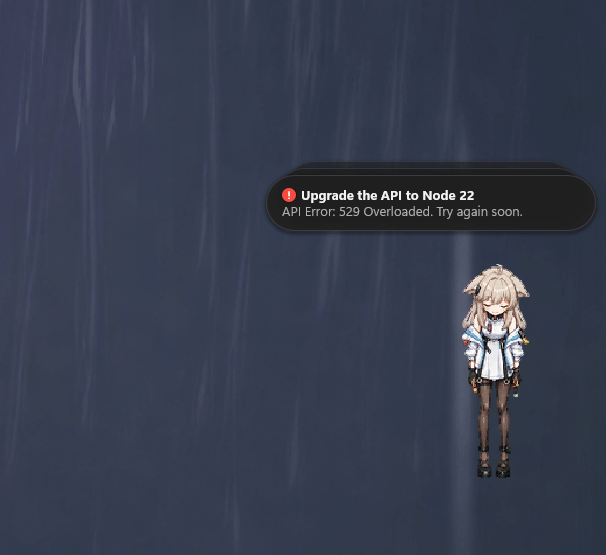
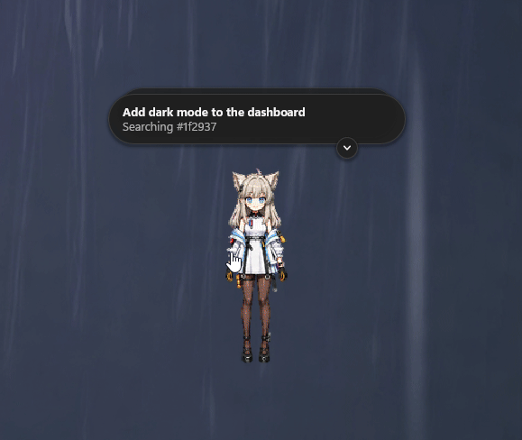

# Claude Pets

**English** · [Русский](README.ru.md)

The Pets/Mini feature from Codex, now in Claude Code desktop on Windows and macOS.
It does everything the original does, but runs dramatically faster because it is written in C++.

All pets use the Codex pets v2 format, so the ones you already have in `~/.codex/pets` work as is.



## What it does

- Shows the status of each Claude desktop session in a bubble.
- Opens the session in Claude when you click its bubble.
- Switches the pet's animation: working, waiting, error, done.
- Can be dragged with the mouse. Release the pet while holding Alt (Option on macOS) and it snaps to a corner or to the middle of a screen edge.
- Turns its head toward the cursor if the pet has look frames.
- Expands the bubble stack on hover and tucks it into a counter with a button.
- Hides in the tray (the menu bar on macOS) with `Ctrl+Alt+P` (`⌃⌥P` on macOS).
- Follows the system light or dark theme.

## Why it is lightweight

- Written in C++20 with no Electron, browser or .NET.
- Windows: Win32 API and Direct2D. The whole pet is a single exe of about 750 KB, and it does not need the Visual C++ Redistributable.
- macOS: AppKit and Core Animation. The app is about 1 MB; bubbles and the pet are layers composited by the GPU, so a frame costs about 0.2 ms of CPU time.
- Uses 20–30 MB of memory.
- Redraws only what changed — a pet frame, a button or a shimmering line — instead of the whole window.
- Supports monitors with different refresh rates.
- Claude Code hooks run asynchronously and without a shell, so Claude never waits for them.
- Tested for leaks.



## Installation

You need Claude desktop with sessions in the **Code** tab.

### Windows

Requires Windows 10 or 11 x64.

1. Download `claude-pets-<version>-win-x64.zip` from the **Releases** page.
2. Extract the archive to a permanent folder, for example `%LOCALAPPDATA%\Programs\ClaudePets`. Autostart stores the full path to the exe, so it is best not to move the folder afterwards.
3. Run `claude-pets.exe`.

### macOS

Requires macOS 13 Ventura or later on Apple Silicon.

1. Download `claude-pets-<version>-macos-arm64.zip` from the **Releases** page and open it.
2. Drag `ClaudePets.app` to the **Applications** folder. Run it from there: macOS starts apps that stay in Downloads from a temporary read-only copy, and the pet then refuses to install hooks or the login item.
3. Open `ClaudePets.app`.

If the release is not notarized, macOS shows "ClaudePets Not Opened" on the first launch. Click **Done**, open **System Settings → Privacy & Security**, click **Open Anyway** next to ClaudePets and confirm. Alternatively, run this once in Terminal:

```bash
xattr -dr com.apple.quarantine /Applications/ClaudePets.app
```

The pet has no Dock icon. When it is hidden, it shows an icon in the menu bar.

The pet appears in the bottom-right corner of the main display. On first launch it takes the pet and size chosen in Codex, if Codex is installed.

## Pets

Pets live in one of two folders:

- `~/.claude/pets/<name>/` (`%USERPROFILE%\.claude\pets\<name>\` on Windows);
- `~/.codex/pets/<name>/` — this is where Codex installs its pets.

Pick the folder in the pet's context menu: **Pets folder**. By default the pet uses `.claude/pets`, and `.codex/pets` if that one is empty.

To bring a pet over from Codex, copy its folder from `.codex/pets` to `.claude/pets`.

## Usage

| Action | Result |
|---|---|
| Click a bubble | The session opens in Claude |
| Hover over the stack | The stack expands to show up to four bubbles; the mouse wheel scrolls through the rest |
| Click **×** on a bubble | The bubble hides until that session's next turn |
| Right-click a bubble (Control-click on macOS) | Bubble menu: **Open session**, **Dismiss**, **Mute this session** |
| Round button on the edge of a bubble | With an arrow, tucks the bubbles into a counter next to the pet; with a number, collapses the expanded stack |
| Click the counter next to the pet | The bubbles come back |
| Click the pet | The Claude window comes to the front |
| Drag the pet | The pet moves; its position is remembered for each monitor |
| Release the pet while holding Alt (Option on macOS) | The pet snaps to a corner or to the middle of a screen edge |
| Right-click the pet (Control-click on macOS) | Menu: pet, size, pets folder, language, start with the system and other settings |
| `Ctrl+Alt+P` (`⌃⌥P` on macOS) | The pet hides in the tray or menu bar, or comes back |

There are four kinds of bubbles:

| Bubble | When it appears |
|---|---|
| Working, shimmering text | A session turn is in progress |
| Waiting for input, orange **!** | Claude asked a question, or is waiting for a decision on a plan or for permission to use a tool |
| Done, green check mark | The turn has finished and you have not opened the session yet |
| Error, red **!** | The turn stopped with an API error |

## Precise status with hooks

Without hooks the pet cannot see tool permission requests. Claude Code hooks tell the pet about such events right away.

1. Open the pet's context menu.
2. Choose **Precise status (Claude Code hooks)** and confirm the installation.

The same menu item removes the hooks. From the command line:

- Windows: `claude-pets.exe --install-hooks` and `claude-pets.exe --uninstall-hooks`;
- macOS: `/Applications/ClaudePets.app/Contents/MacOS/ClaudePets --install-hooks` and `--uninstall-hooks`.

The hooks are added to `~/.claude/settings.json` (`%USERPROFILE%\.claude\settings.json` on Windows). Existing hooks stay in place, and before the first installation a backup `settings.json.claude-pets.bak` is created next to the file. If you move the app, the path in the hooks is updated the next time the pet starts.

If you sync `settings.json` between a Windows PC and a Mac, each pet manages only the hooks for its own system, so both sets can live in the same file. On each machine Claude Code cannot start the other system's command; that asynchronous hook just exits with an error in the background and never blocks Claude.

**Important:** the hooks store the path to the app. Before you uninstall the app, remove the hooks from the menu or with `--uninstall-hooks`. Otherwise the Claude Code settings keep commands that point to a file that no longer exists.

## Settings

Settings are stored in `%APPDATA%\ClaudePets\settings.json` on Windows and in `~/Library/Application Support/ClaudePets/settings.json` on macOS. Almost everything can be changed from the context menu; these fields are worth editing by hand:

| Field | Values |
|---|---|
| `hotkey` | A shortcut such as `Ctrl+Alt+P` or `Win+Alt+Space`; on macOS `Option` and `Cmd` work too; an empty string turns it off |
| `theme` | `auto`, `light`, `dark` |
| `language` | `auto`, `en`, `ru` |
| `petsFolder` | `auto`, `claude`, `codex` |
| `mascotWidth` | Pet width from 80 to 224 |

Edit the file only while the pet is closed: the running app overwrites it with its own values.

## Building from source

### Windows

Requires Visual Studio 2022 or Build Tools 2022 with the MSVC x64 component. CMake and Ninja come with Visual Studio.

```powershell
powershell -ExecutionPolicy Bypass -File build.ps1
```

The executable is written to `build\release\claude-pets.exe`.

- `-Configuration Debug` builds a debug version.
- `-Clean` builds from scratch.
- `-Version 1.2.3` embeds the version. Without it, the latest `v*` tag is used.

### macOS

Requires Xcode or the Xcode Command Line Tools and CMake 3.24 or later. Ninja is used when it is installed.

```bash
brew install cmake ninja
```

```bash
./build.sh
```

The app is written to `build/release/ClaudePets.app` and signed ad hoc.

- `--configuration Debug` builds a debug version.
- `--clean` builds from scratch.
- `--version 1.2.3` embeds the version. Without it, the latest `v*` tag is used.
- `--universal` builds for both Apple Silicon and Intel.

## Releases

Every merge into `dev` publishes a release with both `claude-pets-<version>-win-x64.zip` and `claude-pets-<version>-macos-arm64.zip`. The macOS app is signed with Developer ID and notarized when the repository has these secrets; otherwise it is signed ad hoc:

| Secret | Value |
|---|---|
| `MACOS_CERTIFICATE` | The Developer ID Application certificate with its private key as a base64-encoded `.p12` |
| `MACOS_CERTIFICATE_PASSWORD` | The `.p12` password |
| `MACOS_SIGNING_IDENTITY` | For example `Developer ID Application: Name (TEAMID)` |
| `APPLE_ID`, `APPLE_TEAM_ID`, `APPLE_APP_PASSWORD` | Apple ID, team ID and an app-specific password for notarization |

## License

MIT, see [LICENSE](LICENSE).
